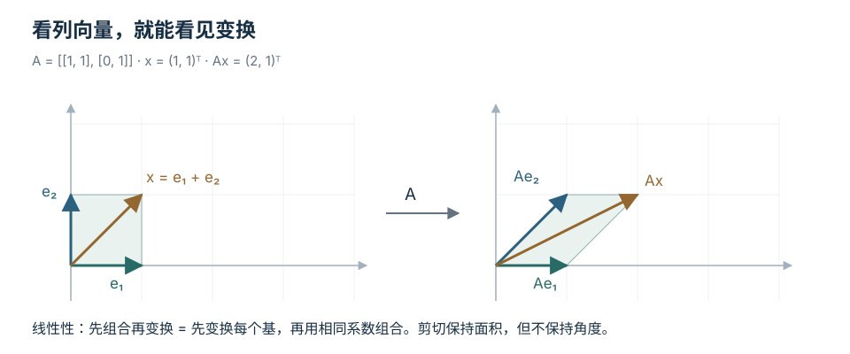
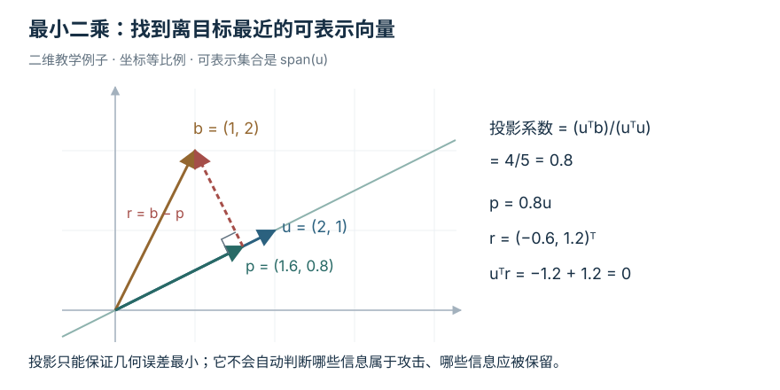
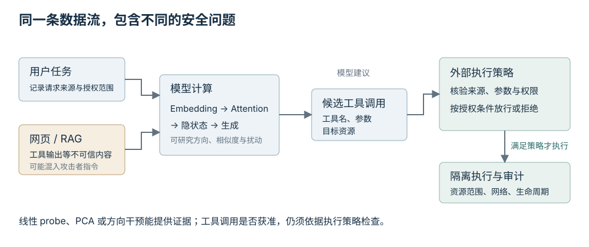

# 线性代数：从几何直觉到 LLM 与 Agent 安全

线性代数研究的核心，是**怎样表示对象，怎样变换对象，以及怎样区分可解释的变化与不可辨认的变化**。在二维平面中，对象可以是箭头；在机器学习中，对象可以是 embedding、模型参数或梯度；在安全分析中，对象可以是一段执行轨迹的特征。它们的语义不同，但常共享一套几何结构。

想象你把 agent 的每次运行表示为一个向量：工具调用次数、外部域名访问数、敏感资源读取数、失败重试数。现在你想判断两个运行是否相似，找出日志中反复出现的行为模式，或者问：“某个检测器根本看不到哪些变化？”这三个问题，依次通向内积与距离、低秩结构、零空间。继续追问检测结果对微小噪声有多敏感，就会遇到奇异值和条件数。

这些联系首先是数学模型。它们是否适用于真实安全任务，还取决于特征怎么构造、标注是否可靠、攻击者能改变什么，以及系统权限如何实施。教程会把数学推导与安全解释连接起来，也会指出连接在哪一步需要额外证据。

## 怎样使用这份教程

第一遍不要从证明开始。先把每章的手算例子算出来，画出对应的箭头或子空间，再读公式。第二遍补上推导和边界；第三遍把同样的结构放到一个小数据集或模型模块中。目标不是重新背一遍定理，而是看到论文中的矩阵公式时，能回答：**它把什么空间映射到什么空间？丢掉了什么信息？什么条件保证结论成立？**

[配套交互教程](exploration-linear-algebra-latest.html) 用图形操作探索投影、谱和 attention；[NumPy 实验](assets/20261012/linear_algebra_lab.py) 则把手算例子变成可修改、可检查的代码。阅读 Markdown 时先自己完成练习，再核对答案。

| 阅读阶段 | 应当能完成的事 | 对应内容 |
| --- | --- | --- |
| 找回基础 | 检查矩阵维度，解释内积、秩、投影；手算小型方程组 | 01–04 |
| 建立结构 | 解释主方向、低秩近似和数值不稳定，知道何时用特征分解或 SVD | 05–06 |
| 进入模型 | 沿张量形状理解注意力、优化与表示分析，把安全研究问题写成可检验的假设 | 后半部分 |

基础来源可沿 [MIT 18.06 课程](https://ocw.mit.edu/courses/18-06-linear-algebra-spring-2010/) 学习线性变换、子空间和正交性，再用 [Mathematics for Machine Learning](https://mml-book.github.io/) 的线性代数、解析几何与矩阵分解章节连接机器学习。本教程的小型数例为教学构造，不是真实模型或安全系统的测量结果。

### 先做四道诊断题

1. `A` 是 `3×2` 矩阵，`x` 是二维列向量。`Ax`、`AᵀA`、`AAᵀ` 分别是什么形状？
2. `x=(1,0)ᵀ`、`y=(2,0)ᵀ` 的余弦相似度是多少？欧氏距离是多少？它们回答的是同一个问题吗？
3. 两个特征列完全相同，增加第二列是否增加可表达的方向？
4. `A=diag(1,0.01)`，观测的第二个分量误差为 `0.001`。解 `Ax=b` 时，第二个解分量会改变多少？

**诊断答案与回看位置。**

1. 分别为 `3×1`、`2×2`、`3×3`。矩阵乘法的中间维度必须匹配，见 02。
2. 余弦为 `1`，距离为 `1`。余弦比较方向，欧氏距离还受长度影响，见 01。
3. 不增加。两个列向量线性相关，第二列没有带来新的方向，见 03。
4. 改变 `0.001/0.01=0.1`。小奇异值会放大观测误差，见 06。


### 贯穿全篇的记号

默认讨论实数，`x ∈ ℝⁿ` 是列向量，`A ∈ ℝᵐˣⁿ` 是 `m` 行、`n` 列的矩阵，`Aᵀ` 是转置，`I` 是单位矩阵。`Ax` 将 `n` 维输入映射到 `m` 维输出。`‖x‖` 未另注明时指欧氏范数；`‖A‖₂` 指矩阵的谱范数。后面讨论按行堆叠的 token 或样本时，会重新说明形状，避免把两种约定混在一起。

---

## 01 向量：把方向、长度与相似性分开

### 向量不只是坐标表

在二维平面中，`x=(3,2)ᵀ` 可理解为“向右 3，向上 2”。`2x=(6,4)ᵀ` 沿同一方向走得更远；`x+y` 是两次位移的合成。

```text
       第二个坐标
           ↑
         2 |       ● x=(3,2)
           |      ↗
           |    ↗
           O────────────→ 第一个坐标
                  3
```

在日志中，`x=(3,2)ᵀ` 也可能表示“3 次文件读取、2 次网络访问”。相同算术可以成立，但几何解释要额外检查：两个坐标是否具有可比较的单位？“增加一次读取”和“增加一次网络访问”是否应被赋予相同权重？未经处理的“访问次数、耗时毫秒、二进制权限标记”直接做欧氏距离，往往会让量纲大的坐标支配结果。

一种处理方法是用训练集的统计量标准化连续特征，或者给距离设置明确权重。标准化选择改变了几何，也就改变了“相似”的含义；它不是没有代价的预处理。在安全任务中，还应避免用测试集或未来日志计算标准化参数，以免泄漏评估信息。

### 内积：一个向量在另一个方向上有多少分量

对于相同维度的两个列向量：

```text
xᵀy = x₁y₁ + ··· + xₙyₙ
‖x‖₂ = √(xᵀx)
xᵀy = ‖x‖₂ ‖y‖₂ cos θ
```

第一行是代数定义，第三行把它连接到夹角。内积为正，两个向量总体朝向接近；为零，二者正交；为负，二者总体相反。不要把“正交”立即翻译成“统计独立”或“语义无关”：那是另外的命题。

手算 `x=(3,0)ᵀ`、`y=(2,2)ᵀ`：

```text
xᵀy = 6
‖x‖₂ = 3，‖y‖₂ = √8
cos θ = 6/(3√8) = 1/√2
θ = 45°
```

如果只关心 `y` 沿 `x` 的方向有多长，先把 `x` 化成单位向量 `u=x/‖x‖=(1,0)ᵀ`。标量 `uᵀy=2` 是带符号的投影长度；向量 `(uᵀy)u=(2,0)ᵀ` 是投影本身。**长度是数，投影是向量。**这一点会在最小二乘中反复出现。

### 范数与距离：选择怎样衡量变化

范数要满足非负性、齐次性和三角不等式，零范数值只对应零向量。常见选择如下：

| 名称 | 定义 | 更敏感的变化 |
| --- | --- | --- |
| `L₁` 范数 | `‖x‖₁=Σᵢ abs(xᵢ)` | 累计绝对变化；常用于稀疏建模 |
| `L₂` 范数 | `‖x‖₂=√(Σᵢxᵢ²)` | 较大的坐标变化会被平方放大 |
| `L∞` 范数 | `‖x‖∞=maxᵢ abs(xᵢ)` | 任意单个坐标的最大变化 |

“`L₀`”通常指非零元素个数，它不满足范数的齐次性，严格说不是范数。两个向量的欧氏距离为 `‖x−y‖₂`；余弦相似度为 `xᵀy/(‖x‖₂‖y‖₂)`，在任一向量为零时未定义，需要实现单独处理。

把 `x=(1,0)ᵀ` 与 `y=(10,0)ᵀ` 比较：余弦为 `1`，距离为 `9`。如果它们表示文档 embedding，方向可能被选作检索依据；如果表示资源消耗，十倍量级差异可能必须保留。**余弦相同，不能推出任务意义上的等价。**

当 `x,y` 都被归一化为单位向量时，有一条有用等式：

```text
‖x−y‖₂² = (x−y)ᵀ(x−y)
         = xᵀx + yᵀy − 2xᵀy
         = 2 − 2 cos θ
```

因此，在全部向量都非零并且已单位归一化的条件下，按余弦相似度从大到小排序，与按欧氏距离从小到大排序等价。去掉单位长度条件，结论就失效。

### 从相似性走向安全判断时缺了什么

检索系统可以用内积找到相关文档；但 embedding 接近只意味着表示空间中的关系，不能据此把文档当作可信指令。类似地，两个执行轨迹的特征很接近，也不能推出它们拥有相同授权。线性代数帮助定义和计算相似性，权限、来源与安全策略需要独立判定。

维度检查：`xᵀy` 为 `(1×n)(n×1)`，结果是标量；外积 `xyᵀ` 为 `(n×1)(1×n)`，结果是 `n×n` 矩阵。它们只是字符次序相近，作用完全不同。

### 练习 01

取 `x=(1,1)ᵀ`、`y=(1,−1)ᵀ`。

1. 算内积、余弦相似度与欧氏距离。
2. 将 `y` 改为 `2y`，哪几个结果改变？
3. 把 `x` 投影到 `y` 张成的直线上，结果是什么？

**核对答案。**

1. `xᵀy=0`，余弦为 `0`，距离为 `2`，两个向量正交。
2. 内积仍为 `0`，余弦仍为 `0`，距离变为 `√10`。乘正数不改变方向，却改变长度。
3. 投影为零向量，因为 `yᵀx=0`。零投影不是说 `x` 不存在，而是说它没有沿这条直线的分量。


## 02 矩阵：一次变换由它怎样移动基向量决定

### 从列向量看矩阵乘法

先看一个 `2×2` 矩阵和输入：

```text
A = [ 2  1 ]，x = [ 1 ]
    [ 0  1 ]      [ 2 ]

Ax = [ 4 ]
     [ 2 ]
```

逐行计算得到 `2×1+1×2=4`、`0×1+1×2=2`。但更有解释力的写法是：

```text
A=[a₁ a₂]，Ax=x₁a₁+x₂a₂
a₁=(2,0)ᵀ，a₂=(1,1)ᵀ
Ax=1a₁+2a₂=(4,2)ᵀ
```

标准基 `e₁=(1,0)ᵀ`、`e₂=(0,1)ᵀ` 经变换后，分别成为矩阵的第一列和第二列。你只要知道基向量怎样移动，就知道每个输入怎样移动，因为任何输入都能写成基向量的线性组合。



上图使用另一个独立二维例子 `S=[[1,1],[0,1]]`：`e₁` 保持不动，`e₂` 移到 `(1,1)ᵀ`，单位方格因此变成平行四边形。这是剪切；它仍保持线性组合关系，但不保持角度和长度。

线性变换满足下面的关系，并非所有函数都具有这种性质：

```text
A(αx+βy)=αAx+βAy
```

因此线性变换必定把零映射到零。加入偏置的 `f(x)=Ax+b` 在 `b≠0` 时是仿射变换，而不是线性变换。神经网络中的“linear layer”通常包含可选偏置，工程命名不改变这个数学区别。

### 组合：乘法顺序就是执行顺序

假设先用 `B` 变换，再用 `A` 变换：`x → Bx → A(Bx)=(AB)x`。右边的矩阵先执行。在两种乘法都有定义时，通常 `AB≠BA`，就像先旋转再沿固定坐标轴拉伸，与先拉伸再旋转通常不同。

手算一个例子，`R` 表示逆时针旋转 90°，`D` 沿第一轴拉伸两倍：

```text
R = [ 0 −1 ]，D = [ 2  0 ]，e₁=(1,0)ᵀ
    [ 1  0 ]      [ 0  1 ]

DR e₁ = D(0,1)ᵀ = (0,1)ᵀ
RD e₁ = R(2,0)ᵀ = (0,2)ᵀ
```

如果 `B ∈ ℝᵏˣⁿ`、`A ∈ ℝᵐˣᵏ`，组合 `AB ∈ ℝᵐˣⁿ`。计算图中的维度检查，本质上就是检查前一操作的输出空间能否接到后一操作的输入空间。

### 转置：让内积从输出空间回到输入空间

转置把行与列交换。它的核心关系是：

```text
(Ax)ᵀy = xᵀ(Aᵀy)
```

左边先把 `x` 映射到输出空间，再与 `y` 做内积；右边把输出空间中的 `y` 通过 `Aᵀ` 拉回输入空间，再与 `x` 做内积。这个关系解释了为何梯度与反向传播中经常出现转置。

具体地，若 `f(x)=cᵀAx`，则每个输入坐标对标量输出的影响组成梯度 `∇ₓf=Aᵀc`。维度为 `(n×m)(m×1)=n×1`，与 `x` 一致。这里是在实数、标准欧氏内积下讨论；复数空间要用共轭转置。

转置不是一般意义上的逆。只有正交方阵 `Q` 满足 `QᵀQ=QQᵀ=I`，才有 `Q⁻¹=Qᵀ`。正交变换保留内积、长度和角度，可以包含旋转或反射；“正交”不等于“只会旋转”。

### 换基：对象不动，描述坐标的尺子变了

取新基 `b₁=(1,1)ᵀ`、`b₂=(1,−1)ᵀ`，组成 `P=[b₁ b₂]`。如果新坐标为 `z=(2,1)ᵀ`，标准坐标就是：

```text
x=Pz=2b₁+b₂=(3,1)ᵀ
```

同一个向量在不同基下有不同坐标。若线性算子在标准基下的矩阵为 `A`，那么在新基下的矩阵是：

```text
A_new=P⁻¹AP
```

读这个式子时，从右向左走：`P` 把新坐标转换成标准坐标，`A` 实施变换，`P⁻¹` 把结果转换回新坐标。要求 `P` 是可逆方阵，也就是新基确实覆盖同一空间。

以 `A=[[2,1],[1,2]]` 为例，沿 `b₁` 的向量被拉长 3 倍，沿 `b₂` 的向量保持长度，因此 `P⁻¹AP=diag(3,1)`。换到合适的基，原来混合坐标的计算变成两个独立的缩放。这正是特征分解的入口。

### 练习 02

`A=[[1,2],[0,1]]`、`x=(2,−1)ᵀ`。

1. 用行计算和列组合两种方法求 `Ax`。
2. 此矩阵是否保持长度？
3. 若 `f(x)=(1,3)Ax`，求 `∇ₓf`。

**核对答案。**

1. `Ax=(0,−1)ᵀ`。列组合为 `2(1,0)ᵀ−(2,1)ᵀ=(0,−1)ᵀ`。
2. 不保持。此例中输入长度为 `√5`、输出长度为 `1`；`AᵀA≠I`。
3. `c=(1,3)ᵀ`，`Aᵀc=(1,5)ᵀ`。直接展开 `f(x)=x₁+5x₂` 也可验证。


## 03 子空间与秩：哪些变化能看见，哪些变化会消失

### 子空间必须包含零，并对线性组合封闭

二维中，过原点的直线是子空间；不过原点的直线不是子空间。三维中，过原点的平面也是子空间。有限组向量的所有线性组合称为它们的张成空间 `span`。

若 `α₁v₁+···+αₖvₖ=0` 只有全部系数为零这一个解，向量组线性独立。否则其中存在冗余。基是一组既线性独立、又能张成整个空间的向量；维数是基向量的个数。增加坐标数，不一定增加独立的信息方向。

### 一个三维观测、二维输入的例子

后面几章反复使用这个矩阵：

```text
    [ 1  0 ]
A = [ 1  1 ]，x=(x₁,x₂)ᵀ
    [ 0  1 ]

Ax=(x₁, x₁+x₂, x₂)ᵀ
```

把输入理解为两个潜在行为量，三个观测分别是“第一个量、二者之和、第二个量”。这只是人为构造的线性传感器。所有可产生的观测都满足 `y₂=y₁+y₃`，因此只能落在三维空间里的一个平面上。矩阵有三行，但只有两个独立输出方向，秩为 `2`。

```text
输入空间 ℝ²             输出空间 ℝ³
任意 (x₁,x₂) ──A──▶    平面 y₂=y₁+y₃
                        平面外的观测无法被精确表示
```

### 四个基本子空间

对于 `A ∈ ℝᵐˣⁿ`、`rank(A)=r`：

| 子空间 | 所在空间 | 定义与含义 | 维数 |
| --- | --- | --- | --- |
| 列空间 `Col(A)` | `ℝᵐ` | 所有 `Ax`，即能产生的输出 | `r` |
| 零空间 `Null(A)` | `ℝⁿ` | 所有满足 `Ax=0` 的输入变化 | `n−r` |
| 行空间 `Col(Aᵀ)` | `ℝⁿ` | 由各行张成的可观测输入方向 | `r` |
| 左零空间 `Null(Aᵀ)` | `ℝᵐ` | 与全部可产生输出正交的方向 | `m−r` |

列空间与左零空间彼此正交，合起来覆盖输出空间；行空间与零空间彼此正交，合起来覆盖输入空间。写成：

```text
ℝᵐ = Col(A) ⊕ Null(Aᵀ)
ℝⁿ = Col(Aᵀ) ⊕ Null(A)
```

`⊕` 在这里表示每个向量都能唯一分解为两个正交分量。例如 `z ∈ Null(A)`，则 `A(x+z)=Ax`：传感器根本看不到沿 `z` 的变化。这是检测盲区的一种精确数学模型。真实系统是否存在这样的线性盲区，要由具体特征映射验证，不能只从类比推断。

对上面的 `3×2` 矩阵，行空间是整个 `ℝ²`，零空间只有零向量，列空间是平面 `y₂=y₁+y₃`，左零空间由 `n=(1,−1,1)ᵀ` 张成。直接验证 `Aᵀn=0`。输入没有被压丢，但输出仍只能覆盖二维平面。

### 方程的存在性与唯一性是两个问题

`Ax=b` 有解，当且仅当 `b∈Col(A)`。若有一个解 `x₀`，全部解是 `x₀+Null(A)`。因此：

```text
有解：b 在列空间中。
有唯一解：有解，并且 Null(A)={0}。
```

非方阵也可以有唯一解。例如本例中 `b=(1,3,2)ᵀ` 对应唯一的 `x=(1,2)ᵀ`。但是 `b=(1,2,2)ᵀ` 不在平面中，无精确解。未知数少于方程数，不代表必定无解；未知数多于方程数，则不能有全列秩，有解时不会唯一。

### 消元的本质：把依赖关系显露出来

对 `b=(1,2,2)ᵀ` 写增广矩阵：

```text
[ 1  0 | 1 ]      [ 1  0 | 1 ]      [ 1  0 | 1 ]
[ 1  1 | 2 ]  →   [ 0  1 | 1 ]  →   [ 0  1 | 1 ]
[ 0  1 | 2 ]      [ 0  1 | 2 ]      [ 0  0 | 1 ]
```

最后一行要求 `0=1`，揭示不一致。若 `b=(1,3,2)ᵀ`，最后一行变为 `0=0`，没有新增约束。主元数给出矩阵的秩；自由变量对应可沿零空间改变的自由度。

另一个矩阵 `C=[[1,2],[2,4]]` 只有秩 `1`。解 `Cx=(3,6)ᵀ` 时，全部约束只是 `x₁+2x₂=3`，所以 `x=(3−2t,t)ᵀ`。两条看似不同的方程实际上重复了同一件事。

在数据处理中，完全重复的特征会制造这种相关性；近似重复则会制造下一章之后讨论的数值不稳定。精确秩与“数值上有效的秩”需要分开：浮点矩阵中很小而非零的奇异值，可能来自噪声。所谓数值秩必须报告阈值或判定规则。

### 练习 03

`C=[[1,2],[2,4]]`。

1. 求列空间和零空间的一组基。
2. `Cx=(3,7)ᵀ` 是否有解？
3. 任何解 `x` 加上哪个方向，都不会改变 `Cx`？

**核对答案。**

1. 列空间由 `(1,2)ᵀ` 张成；零空间由 `(-2,1)ᵀ` 张成。
2. 无解，因为第二个输出必须是第一个的两倍，`7≠2×3`。
3. 加上 `t(-2,1)ᵀ`，任意实数 `t` 都不会改变输出。这并不意味着输入相同，而是它们在该观测下不可区分。


## 04 投影与最小二乘：找不到精确答案时，定义最好的近似

### 投影要求残差与目标子空间正交

先把 `b=(2,1)ᵀ` 投影到 `a=(1,1)ᵀ` 张成的直线上。任何候选点为 `ta`，要最小化：

```text
‖b−ta‖₂²=(2−t)²+(1−t)²
```

导数为 `4t−6`，令它等于零，得 `t=3/2`。投影 `p=(3/2,3/2)ᵀ`，残差 `r=b−p=(1/2,−1/2)ᵀ`，满足 `aᵀr=0`。

一般公式为 `p=a(aᵀb)/(aᵀa)`，要求 `a≠0`。投影矩阵 `P=aaᵀ/(aᵀa)` 满足 `Pᵀ=P`、`P²=P`：投影一次之后，第二次不会再改变结果。这里讨论的是正交投影；一般斜投影虽也可满足 `P²=P`，却不一定对称。



图中改用方向 `u=(2,1)ᵀ` 与观测 `b=(1,2)ᵀ`；`u` 并非单位向量。投影系数为 `uᵀb/(uᵀu)=4/5`，因此 `p=(1.6,0.8)ᵀ`，残差为 `(-0.6,1.2)ᵀ`，与 `u` 正交。换了数值，分解原则完全相同。

### 最小二乘是在列空间中选最近的点

对于无法精确满足的 `Ax=b`，改求：

```text
minₓ ‖Ax−b‖₂²
```

这里的“最佳”只相对于所选的平方欧氏损失，不自动意味着统计上最优、安全上可靠或对异常值稳健。选择权重或更换损失，答案可能变化。

目标函数展开为 `xᵀAᵀAx−2xᵀAᵀb+bᵀb`。梯度为 `2Aᵀ(Ax−b)`，于是最优解满足正规方程：

```text
AᵀA x̂=Aᵀb
Aᵀ(b−Ax̂)=0
```

第二行比第一行更容易形成几何直觉：残差与 `A` 的每个列方向正交，因此不能通过沿任何可表达方向移动，进一步降低距离。

继续使用 `A=[[1,0],[1,1],[0,1]]`、`b=(1,2,2)ᵀ`：

```text
AᵀA = [ 2  1 ]，Aᵀb = [ 3 ]
       [ 1  2 ]         [ 4 ]

2x̂₁+x̂₂=3，x̂₁+2x̂₂=4
x̂=(2/3,5/3)ᵀ

p=Ax̂=(2/3,7/3,5/3)ᵀ
r=b−p=(1/3,−1/3,1/3)ᵀ
```

`r` 恰好沿左零空间方向 `(1,−1,1)ᵀ`，`Aᵀr=0`。任何候选 `Ax` 都在平面内，`r` 垂直于平面。你无法靠调节输入解释这部分观测；它可能是测量噪声、模型缺失，也可能是异常行为，数学本身不会替你区分原因。

### QR：先换成正交坐标，再解三角方程

当 `A` 满列秩时，薄 QR 分解写成 `A=QR`，其中 `Q ∈ ℝᵐˣⁿ` 的列正交且长度为 `1`，`R ∈ ℝⁿˣⁿ` 是可逆上三角矩阵。列空间不变，但基变得更容易计算投影：

```text
p=QQᵀb
Rx̂=Qᵀb
```

本例可以手算 Gram–Schmidt 的两步：

```text
q₁=(1,1,0)ᵀ/√2
q₂=(-1,1,2)ᵀ/√6

R = [ √2  1/√2 ]，Qᵀb = [ 3/√2 ]
    [  0   √6/2 ]          [ 5/√6 ]
```

先解第二行得 `x̂₂=5/3`，再解第一行得 `x̂₁=2/3`。教学上 Gram–Schmidt 便于看懂正交化；实际数值计算常采用 Householder QR 等稳定算法。不要因为正规方程方便推导，就在代码里显式求 `(AᵀA)⁻¹`。对满列秩矩阵，`κ₂(AᵀA)=κ₂(A)²`；构造正规方程会加重病态问题。使用库提供的 least-squares、QR 或 SVD 求解更合适。

### 岭回归：用偏差换取稳定性

若特征高度相关，参数可能对噪声极敏感。岭回归在拟合误差上加上参数长度惩罚：

```text
minₓ ‖Ax−b‖₂² + λ‖x‖₂²，λ>0
(AᵀA+λI)x̂λ=Aᵀb
```

`λ>0` 时，`AᵀA+λI` 是正定的，所以即便原矩阵不满秩，也有唯一解。对上例取 `λ=1`：

```text
[ 3  1 ] x̂λ = [ 3 ]，x̂λ=(5/8,9/8)ᵀ
[ 1  3 ]       [ 4 ]
```

参数长度减小，但原始拟合残差增大。这里的“收缩”是整体或奇异方向上的性质，不能说每个原始坐标都一定按同一比例缩小。`λ` 的数值还与损失是否除以样本数、特征尺度有关；比较实现时要先对齐定义。

如果使用最小二乘残差做安全异常检测，应先问：异常是否会落在模型列空间内？攻击者是否能操纵训练样本或特征？一个完美拟合的观测可能仍然违规，一个大残差也可能只是分布变化。残差定义了“未被这个线性模型解释”，没有直接定义“恶意”。

### 练习 04

取 `a=(1,2)ᵀ`、`b=(2,0)ᵀ`。

1. 求 `b` 在 `span(a)` 上的正交投影和残差。
2. 验证残差正交。
3. 如果加上 `λt²`、取 `λ=1`，最优系数 `t` 是多少？

**核对答案。**

1. `t=(aᵀb)/(aᵀa)=2/5`，投影为 `(2/5,4/5)ᵀ`，残差为 `(8/5,−4/5)ᵀ`。
2. `aᵀr=8/5−8/5=0`。
3. 最小化 `(2−t)²+(2t)²+t²`，导数为 `12t−4`，所以 `t=1/3`。此时原始拟合残差不再与 `a` 正交；正规条件是 `aᵀr=λt`。


## 05 特征值与二次型：找到变换自己的自然方向

### 哪些方向经过变换后仍沿原来的线

特征向量满足 `Av=λv`，其中 `v≠0`，要求 `A` 是方阵。沿 `v` 输入时，变换只做缩放：正特征值保留方向，负特征值翻转方向，零特征值把向量压到零。

对 `B=[[2,1],[1,2]]`：

```text
B(1,1)ᵀ = (3,3)ᵀ = 3(1,1)ᵀ
B(1,−1)ᵀ = (1,−1)ᵀ
```

两条特征方向分别是“两个坐标一起改变”和“两个坐标反向改变”，特征值为 `3` 与 `1`。一般输入 `x` 可分解为这两条方向的组合，然后分别缩放。若将特征向量单位化，得到：

```text
q₁=(1,1)ᵀ/√2，q₂=(1,−1)ᵀ/√2
B=QΛQᵀ，Q=[q₁ q₂]，Λ=diag(3,1)
```

于是 `Bᵏx` 中，沿 `q₁` 的分量会乘上 `3ᵏ`，沿 `q₂` 的分量保持。这解释了重复线性变换为什么可能让某些方向逐渐占主导。现实深度网络包含非线性、残差连接和归一化，不能直接用一个固定矩阵的幂替代整个网络；局部线性化才可能给出有限范围的分析。

### 对称矩阵为什么特别适合几何分析

实对称矩阵的特征值为实数，可以选择一组正交单位特征向量，得到 `B=QΛQᵀ`。因此不会遇到彼此歪斜的特征基。一般实方阵可能有复数特征值，也可能不能对角化。例如平面旋转 90° 的矩阵没有实特征方向；`[[1,1],[0,1]]` 只有一条独立特征方向。

这也是为何协方差矩阵、`AᵀA`、某些图矩阵适合用谱来分析。不要把对称矩阵的漂亮性质无条件套在任意神经网络权重上。

### 二次型：把方向上的代价写成一个标量

对于对称矩阵 `B`，二次型 `xᵀBx` 把输入方向转成一个数。用 `z=Qᵀx` 换到特征坐标：

```text
xᵀBx = zᵀΛz = Σᵢ λᵢzᵢ²
```

因此 `B` 半正定（PSD）等价于全部特征值非负；正定等价于全部特征值严格为正。半正定允许某些非零方向的代价为零，正定不允许。对本例：

```text
xᵀBx=2x₁²+2x₁x₂+2x₂²
     =3z₁²+z₂²
```

同样长度的输入，沿 `q₁` 的代价是沿 `q₂` 的三倍。等代价曲线因此是椭圆，不是圆。半正定矩阵不是指“每个元素非负”：`[[1,−1],[−1,1]]` 有负元素，却是半正定，因为二次型为 `(x₁−x₂)²`。

两个重要来源都能直接证明：

```text
xᵀAᵀAx=‖Ax‖₂²≥0，所以 AᵀA 半正定。
xᵀCx=(1/N)Σⱼ[xᵀ(zⱼ−μ)]²≥0，所以协方差矩阵 C 半正定。
```

第二式使用以 `1/N` 定义的样本协方差；用 `1/(N−1)` 的无偏估计也保持半正定。在最小二乘中，Hessian 为 `2AᵀA`；特征值表示不同方向上的曲率。某个方向曲率很小，参数沿它移动很远也只带来很小损失变化，这与不可辨认性和优化困难相连。

### 图拉普拉斯：网络上的“邻居差异”

考虑三个节点组成一条无向链：`1—2—3`。令 `W` 是邻接矩阵，`D` 是节点度数对角矩阵，非归一化拉普拉斯为 `L=D−W`：

```text
    [ 1 −1  0 ]
L = [−1  2 −1 ]
    [ 0 −1  1 ]

xᵀLx=(x₁−x₂)²+(x₂−x₃)²
```

对无向、非负边权图，一般有 `xᵀLx=Σ_{i<j} wᵢⱼ(xᵢ−xⱼ)²`。所以 `L` 半正定。常量向量 `(1,1,1)ᵀ` 的特征值是零，因为每条边两端都一样；本例另外两个特征值为 `1` 和 `3`，对应方向 `(1,0,−1)ᵀ`、`(1,−2,1)ᵀ`。较大的特征值对应在这张图上变化更剧烈的方向。

如果节点表示主机、边表示某种关联，`x` 表示风险分数，这个二次型可衡量分数在相连节点间是否平滑。但“通信关系”和“风险相似”必须由任务证据支持；被攻陷主机与正常主机通信，不意味着它们应具有同样标签。真实网络常是有向、加权且随时间变化的，套用无向拉普拉斯前要明确构图方式。

### 练习 05

`H=[[1,−1],[−1,1]]`。

1. 求两个特征值和对应方向。
2. `H` 是正定还是半正定？
3. `x=(5,5)ᵀ` 与 `y=(1,−1)ᵀ` 的二次型分别为多少？这说明什么？

**核对答案。**

1. `(1,1)ᵀ` 的特征值为 `0`，`(1,−1)ᵀ` 的特征值为 `2`。
2. 半正定，非正定；非零常量方向的代价为零。
3. 分别为 `0` 与 `4`。二次型看的是坐标差异，整体共同增加不会增加此代价。范数大的向量不一定有更大的特定二次型。


## 06 SVD：任何矩阵都能拆成方向、增益与方向

### 特征分解处理“自己的方向”，SVD 连接两个空间

矩阵可能是长方形，输入与输出甚至不在同一维度，此时 `Av=λv` 没有合适的维度。奇异值分解（SVD）适用于任意实矩阵。

设 `A` 的秩为 `r`，紧凑 SVD 为：

```text
A=UᵣΣᵣVᵣᵀ
Uᵣ ∈ ℝᵐˣʳ，Σᵣ ∈ ℝʳˣʳ，Vᵣ ∈ ℝⁿˣʳ
Σᵣ=diag(σ₁,…,σᵣ)，σ₁≥···≥σᵣ>0
```

`Uᵣ`、`Vᵣ` 的列分别是输出和输入空间中的正交单位方向。对每一对方向，有 `Avᵢ=σᵢuᵢ`。输入沿 `vᵢ` 的分量，会以增益 `σᵢ` 变成输出沿 `uᵢ` 的分量。

```text
输入 x ──Vᵣᵀ──▶ 可辨认方向的坐标 ──Σᵣ──▶ 缩放 ──Uᵣ──▶ 输出 Ax
   └─输入的零空间分量被丢弃，无法从输出恢复
```

若使用完整的正交基，SVD 也可写成 `A=UΣVᵀ`，其中 `U`、`V` 是方阵，`Σ` 是 `m×n` 的矩形对角矩阵。紧凑形式只保留非零奇异方向；两种记法表达的是同一个变换。SVD 的方向可能包含反射，不应笼统称为“两次旋转”。

### 手算贯穿例子的 SVD

对 `A=[[1,0],[1,1],[0,1]]`，先计算 `AᵀA=[[2,1],[1,2]]`。它的特征值为 `3`、`1`，因此奇异值为 `√3`、`1`，右奇异向量为：

```text
v₁=(1,1)ᵀ/√2，v₂=(1,−1)ᵀ/√2
u₁=Av₁/√3=(1,2,1)ᵀ/√6
u₂=Av₂=(1,0,−1)ᵀ/√2
```

检查：`u₁ᵀu₂=0`，每个向量长度为 `1`。矩阵可以写成两个秩一项之和：

```text
A=√3 u₁v₁ᵀ + u₂v₂ᵀ
```

第一项表达输入两个坐标共同变化的模式，第二项表达它们相反变化的模式。左零空间方向 `(1,−1,1)ᵀ/√3` 与两条输出方向都正交。

关系 `AᵀA vᵢ=σᵢ²vᵢ` 解释了奇异值与特征值的联系；它方便手算，但数值库不必通过先显式构造 `AᵀA` 来计算 SVD，因为这样会平方条件数。

### 伪逆：在能恢复的方向上除以增益

可逆方阵能直接求逆；一般矩阵用 Moore–Penrose 伪逆：

```text
A⁺=VᵣΣᵣ⁻¹Uᵣᵀ ∈ ℝⁿˣᵐ
x̂=A⁺b
```

`x̂` 是所有最小二乘解中欧氏范数最小的那个。几何上：先将 `b` 投影到能解释的输出方向，再除以各方向的增益，再映射回输入空间；输入零空间的分量取零，因为输出无法决定它。

满列秩时 `A⁺=(AᵀA)⁻¹Aᵀ`，但这是公式，不是建议在程序中显式求逆。本例：

```text
      1 [ 2  1 −1 ]
A⁺ =  ─ [−1  1  2 ]
      3

A⁺(1,2,2)ᵀ=(2/3,5/3)ᵀ
```

对于秩亏矩阵 `C=[[1,2],[2,4]]`，解 `Cx=(3,6)ᵀ` 有无穷多个，伪逆选择 `x=(3/5,6/5)ᵀ`。验证它满足 `x₁+2x₂=3`，并且与零空间方向 `(-2,1)ᵀ` 正交。因此没有浪费长度在不影响输出的方向上。

### 低秩近似：保留最大的奇异方向

保留前 `k` 个奇异方向：

```text
Aₖ=Σᵢ₌₁ᵏ σᵢuᵢvᵢᵀ
```

它在谱范数和 Frobenius 范数下都是最佳的秩不超过 `k` 的近似。误差如下；当 `k=r` 时约定 `σᵣ₊₁=0`，完整保留后误差为零：

```text
‖A−Aₖ‖₂=σₖ₊₁
‖A−Aₖ‖F²=Σᵢ₌ₖ₊₁ʳ σᵢ²
‖A‖F²=Σᵢ σᵢ²=Σᵢⱼ aᵢⱼ²
```

本例的秩一近似为：

```text
        1 [ 1  1 ]
A₁ =    ─ [ 2  2 ]
        2 [ 1  1 ]
```

它保留 `3/(3+1)=75%` 的平方奇异值总量，舍弃的谱范数与 Frobenius 范数误差都为 `1`。对 `x=(1,1)ᵀ`，`A₁x=Ax`；对 `x=(1,−1)ᵀ`，`A₁x=0`，但 `Ax=(1,0,−1)ᵀ`。总体能量保留不少，不代表每个输入都保留得好。

这是安全研究需要特别留意的区别：训练数据里的低方差方向可能少见，却可能承担关键的权限、触发条件或攻击信号。数学上的最佳低秩重构，优化的是矩阵误差；下游任务的安全表现需要单独测试。反过来，采用低秩参数化也不意味着它恰好等于某个原矩阵的截断 SVD。

### 条件数：问题本身怎样放大误差

谱范数 `‖A‖₂=σ₁` 表示单位长度输入可被放大的最大倍数。对可逆方阵，二范数条件数为：

```text
κ₂(A)=‖A‖₂‖A⁻¹‖₂=σ_max/σ_min
```

它衡量最强与最弱方向的增益相差多大。看 `D=diag(1,0.01)`：输入的第二方向被压小一百倍，反求输入就要放大一百倍。若 `b=(1,0.01)ᵀ`，真实解为 `(1,1)ᵀ`；观测变成 `(1,0.011)ᵀ` 时，解变成 `(1,1.1)ᵀ`。输出中仅 `0.001` 的扰动，制造了输入中 `0.1` 的变化。

当 `A` 固定且可逆、`b≠0`，只有观测发生扰动时，`δx=A⁻¹δb`。结合 `‖δx‖≤‖A⁻¹‖₂‖δb‖` 和 `‖b‖≤‖A‖₂‖x‖`，得到相对误差界：

```text
‖δx‖₂/‖x‖₂ ≤ κ₂(A) · ‖δb‖₂/‖b‖₂
```

这是最坏情况上界，并不表示每次扰动都被放大同样的倍数；扰动方向也决定结果。若连 `A` 自身也有误差，需要另外的扰动分析。

对满列秩的长矩阵，`σ_max/σ_min` 同样刻画逆问题在可辨认方向上的敏感性。本篇贯穿矩阵的条件数是 `√3`，相对温和。秩亏时，完整输入无法唯一恢复，不能只报告非零奇异值的比值而忽略零空间；这个比值至多描述可辨认子空间上的条件数。

病态是问题对扰动敏感；算法不稳定是计算过程又引入额外误差。稳定算法能避免不必要的误差，不能让数据本身不存在的信息重新出现。浮点精度、噪声幅度、奇异值阈值与正则化必须一起考虑。

SVD 还能解释岭回归。每个非零奇异方向上的解系数，由伪逆的 `1/σᵢ` 改为：

```text
σᵢ/(σᵢ²+λ)
```

当 `σᵢ` 很小时，不再猛烈除以一个小数。这改善稳定性，同时抑制沿该方向的信号。截断 SVD 直接舍弃阈值以下的方向，岭回归则平滑衰减；两者都需要根据数据和任务选择参数。

### 练习 06

`D=diag(4,1,0.1)`。

1. 求谱范数与条件数。
2. 最佳秩二近似是什么？谱误差与 Frobenius 误差是多少？
3. 观测第三分量误差 `0.01`，无正则反求输入时误差是多少？若使用岭回归 `λ=0.01`，该方向上的增益变为多少？

**核对答案。**

1. `‖D‖₂=4`，`κ₂(D)=4/0.1=40`。
2. `D₂=diag(4,1,0)`，两种误差都是 `0.1`。平方能量保留比例为 `17/17.01`，约 `99.94%`，但第三方向完全消失。
3. 无正则解误差为 `0.01/0.1=0.1`。岭回归该方向增益为 `0.1/(0.1²+0.01)=5`，所以由这项观测误差引起的解变化为 `0.05`。此计算只比较噪声传播，还没有计入岭回归对真实信号引入的偏差。


### 到这里，你已经有了一套可以迁移的检查方法

读到一个矩阵公式时，先确认输入、输出和单位；再找列空间与零空间，判断什么能表示、什么被丢弃；然后用正交投影解释近似；最后看谱与奇异值，区分主要模式、不可辨认方向和噪声放大。接下来把这套方法放进数据矩阵、梯度、attention 与 agent 安全案例中，重点会转向模型假设怎样与实际系统相接。

## 07 从一条向量到一团数据：协方差、PCA 与异常距离

前面讨论的是一个向量如何变化。研究模型表征或安全日志时，通常有许多向量：不同提示词的激活、不同会话的工具调用特征、不同时间窗口的网络统计量。新的问题是：**哪些方向经常变化，哪些变化相对于正常分布很不寻常？**

### 7.1 先中心化，再谈变化方向

设有 `n` 个样本，每个样本是列向量 `xᵢ ∈ ℝᵈ`。为便于批量计算，把样本转置后按行堆叠成 `X ∈ ℝ^(n×d)`。均值是

```text
μ= 1/n Σ(i=1…n) xᵢ ∈ ℝᵈ,
X_c=X- 1 μᵀ.
```

这里 `1` 是 `n` 维全 1 列向量，`1μᵀ` 把同一个均值按行重复，供每个样本减去。

样本协方差采用 `n-1` 作分母，需要 `n≥2`。当样本独立同分布且具有有限二阶矩时，这个估计对总体协方差无偏：

```text
C= 1/(n-1) X_cᵀ X_c ∈ ℝ^(d×d).
```

元素 `C_jj` 是第 `j` 个特征的样本方差；`C_jk` 描述两个特征共同增减的程度。协方差有单位，字节数与请求数直接混用可能让大数值特征支配方向。标准化、取对数或重新定义特征，会改变正在研究的几何，应根据问题选择，不能把预处理当成无影响的清洗。

任取 `a ∈ ℝᵈ`，有

```text
aᵀ Ca= 1/(n-1) ‖X_c a‖₂²≥0.
```

所以 `C` 对称且半正定。这个等式还有直观意义：线性读出 `aᵀx` 的样本方差就是 `aᵀCa`。当 `‖a‖₂=1` 时，它也是沿单位方向 `a` 的投影方差。

为什么必须中心化？两个样本 `x₁=(10,1)ᵀ,x₂=(10,-1)ᵀ` 的真正变化沿纵轴。未中心化时，二阶矩 `Xᵀ X/2= diag(100,1)` 会把共同的横坐标偏移解释成大能量；中心化后的样本协方差是 `diag(0,2)`。均值位置与变化方向回答不同问题。

### 7.2 PCA 是寻找变化最大的正交坐标

第一主成分寻找单位方向 `u`，使投影方差最大：

```text
在 ‖u‖₂=1 下最大化 uᵀCu.
```

用拉格朗日乘子写 `uᵀ Cu-λ(uᵀ u-1)`，对 `u` 求导得到 `Cu=λ u`。取最大特征值对应的特征向量，就得到第一主成分。后续方向添加与此前方向正交的约束。

若 `C=UΛ Uᵀ`，且 `λ₁≥…≥λ_d≥0`，保留前 `k` 个方向，记 `Uₖ ∈ ℝ^(d×k)`。样本的低维坐标与重建分别是

```text
zᵢ=Uₖᵀ(xᵢ-μ) ∈ ℝᵏ,
x̂ᵢ=μ+Uₖ zᵢ.
```

解释方差比例为 `Σ(j=1…k) λⱼ/Σ(j=1…d) λⱼ`，分母为零时这个比例没有定义。它衡量保留了多少总方差，**没有使用任何安全标签**。如果攻击特征只沿一个低方差方向改变，追求高解释方差的降维可能恰好删掉它。

PCA 与 SVD 是同一件事的两个入口。若中心化数据的紧致 SVD 是 `X_c=U_XΣ Vᵀ`，则

```text
C=V Σ²/(n-1) Vᵀ.
```

这里 `V` 的列是特征空间里的主方向，`U_X` 描述样本组合；不要因字母都叫 `U` 就把两个空间混为一谈。实际计算通常直接分解 `X_c`，不必先构造 `C`。协方差、PCA 与 SVD 的系统基础见 [Mathematics for Machine Learning，第 4、6、10 章](https://mml-book.github.io/book/mml-book.pdf)。

### 7.3 白化与 Mahalanobis：把椭圆改写成圆

看一个完全合成的二维分布，均值为零，协方差为

```text
C=[[9, 0], [0, 1]].
```

横轴的标准差是 `3`，纵轴是 `1`。点 `a=(3,0)ᵀ` 的欧氏距离为 `3`，点 `b=(0,2)ᵀ` 为 `2`。但 `a` 只偏离一个横向标准差，`b` 偏离两个纵向标准差。

如果 `C` 正定，PCA 白化可以写成

```text
z=Λ^(-1/2)Uᵀ(x-μ).
```

在估计这组协方差的训练样本上，白化坐标的样本协方差是 `I`。上述例子就是 `z=(x₁/3,x₂)ᵀ`。对应的 Mahalanobis 距离平方为

```text
D_M²(x)=(x-μ)ᵀ C⁻¹(x-μ)=‖z‖₂².
```

所以 `D_M²(a)=1,D_M²(b)=4`。它没有发现“恶意”，只是使用正常数据的尺度与相关性，重新定义了偏离程度。

白化不是独立性证明。协方差为单位阵只保证二阶不相关；一般分布仍可能存在非线性依赖。PCA 白化、ZCA 白化可选择不同的输出坐标，虽然都能产生单位协方差，坐标本身不能直接当成自然语义。

### 7.4 高维时，逆矩阵经常不存在

中心化以后 `X_c` 的各行和为零，因此

```text
rank(C)= rank(X_c)≤min(d,n-1).
```

如果只有 `n=100` 个提示词，却收集 `d=4096` 维激活，样本协方差一定奇异。就算 `n>d`，强相关特征或很小的特征值也可能导致数值不稳定。直接调用逆矩阵不解决统计信息不足。

常见办法是降维、使用收缩估计，或计算正则化分数

```text
D_λ²(x)=(x-μ)ᵀ(C+λ I)⁻¹(x-μ), λ>0.
```

它与未经正则化的 Mahalanobis 距离不同：小特征值方向的放大被限制了，阈值也要重新校准。使用伪逆会忽略零特征值方向，而训练数据恰好没有覆盖的方向未必安全。除非另有建模理由，不能把该方向距离为零解读为无风险。

安全日志经常偏态、重尾、混合多个工作负载，还会随部署改变。均值与协方差都可能受少数异常样本影响。把距离平方直接套入一个通用阈值需要额外分布假设；例如已知真实均值、正定协方差的高斯变量有卡方性质，但估计参数、正则化与分布漂移都会改变这个简单结论。对实际检测器，阈值应该在独立校准集上选择，并在按时间切分的测试集上检查误报。

### 练习 7：大变化与罕见变化

给定上述 `C= diag(9,1)`，第三个点 `c=(3,2)ᵀ` 的 Mahalanobis 距离平方是多少？若仅保留第一主成分，`c` 的重建误差平方是多少？这两个数是否可以直接叫作攻击概率？

**答案：** `D_M²(c)=3²/9+2²=5`；第一主成分是横轴，重建为 `(3,0)ᵀ`，误差平方为 `4`。两个量都是分数，需要真实标签、独立校准和明确定义的威胁模型才能评估检测价值，不能直接称为攻击概率。

## 08 从线性映射到学习：矩阵求导、反向传播与局部敏感性

研究模型安全时，你经常要回答“哪个输入变化会使某个输出更强”。线性代数提供坐标与映射，微积分告诉你映射在当前位置如何响应变化。这里先掌握一次局部变化，不需要把整个深度学习优化理论一起学完。

### 8.1 用微分保持形状清楚

设 `W ∈ ℝ^(m×d),x ∈ ℝᵈ,y ∈ ℝᵐ`，预测为 `Wx`，损失为

```text
ℓ(W,x)= 1/2 ‖Wx-y‖₂².
```

令残差 `r=Wx-y ∈ ℝᵐ`。对输入求微分：

```text
dℓ=rᵀ W dx=(Wᵀ r)ᵀ dx,
∇_xℓ=Wᵀ r ∈ ℝᵈ.
```

对权重求微分：

```text
dℓ=rᵀ(dW)x
= tr((rxᵀ)ᵀ dW),
∇_Wℓ=rxᵀ ∈ ℝ^(m×d).
```

梯度的形状必须与被求导对象一致。`rxᵀ` 是外积，得到一个矩阵；`xᵀ r` 在 `m≠d` 时甚至没有定义。

小例子：

```text
W=[[2, 0], [1, 1]],
x=[[1], [2]],
y=[[1], [1]].
```

得到 `Wx=(2,3)ᵀ,r=(1,2)ᵀ,ℓ=2.5`，于是

```text
∇_xℓ=(4,2)ᵀ,
∇_Wℓ=[[1, 2], [2, 4]].
```

这个梯度描述的是损失增加最快的一阶方向。沿负梯度走小步是局部下降；走太大步时，一阶描述不能保证行为。

### 8.2 Jacobian 把“一个梯度”推广到“多个输出”

对 `f: ℝᵈ→ ℝᵐ`，Jacobian 是

```text
J_f(x) ∈ ℝ^(m×d),
(J_f)_ij= (∂ fᵢ)/(∂ xⱼ) .
```

它把输入的小扰动映射到输出的小扰动：

```text
f(x+δ)≈ f(x)+J_f(x)δ.
```

若 `f(x)=σ(Wx+b)`，且 `σ` 逐元素作用，则

```text
J_f(x)= diag(σ'(Wx+b))W.
```

上游损失的梯度为 `g=∇_fℓ ∈ ℝᵐ`，反向传播就是

```text
∇_xℓ=J_f(x)ᵀ g.
```

多层网络反复使用链式法则。实践中通常不显式存储完整 Jacobian，而计算向量与 Jacobian 的乘积。反向模式自动微分擅长计算这里的 `J_fᵀ g`；理解这个形状能帮助你检查 hook、激活干预与梯度代码。

以 ReLU 为例，正区间导数为 `1`，负区间为 `0`，零点不可微。一个维度即使权重很大，当前激活落在负区间时局部导数仍可能为零；越过激活边界以后，线性近似会改变。因此“当前梯度小”与“任意允许输入变化都安全”之间还有距离。矩阵微分与链式法则可对照 [Mathematics for Machine Learning，第 5 章](https://mml-book.github.io/book/mml-book.pdf)。

### 8.3 softmax 的导数解释了竞争与共同平移

令 `pᵢ=exp(zᵢ)/(Σⱼ exp(zⱼ))`，则

```text
(∂ pᵢ)/(∂ zⱼ) =pᵢ( 1[i=j]-pⱼ),
J_softmax=diag(p)-ppᵀ.
```

这里 `1[i=j]` 在 `i=j` 时为 1，否则为 0。提高一个 logit，会改变多个概率，因为总和仍是 `1`。此外 `J1=0`：给所有 logits 加同一个常数，概率不变。这也解释了实现时为什么可以先减去最大 logit，提高数值稳定性。

若 `p=(1/2,1/2)ᵀ`，则

```text
J=[[1/4, -1/4], [-1/4, 1/4]].
```

沿 `(1,1)ᵀ` 平移没有变化；沿 `(1,-1)ᵀ` 改变两类的竞争关系。安全相关分数应该明确是某个 logit、logit 差、概率还是完整行为，这些对象有不同的局部响应。

### 8.4 范数界：能说明敏感性，但需要合适的扰动空间

对线性映射有精确界

```text
‖Wδ‖₂≤‖W‖₂‖δ‖₂,
```

其中矩阵谱范数 `‖W‖₂=σ_max(W)`。对非线性 `f`，当前位置的 `‖J_f(x)‖₂` 给出一阶最大放大率；要获得一个有限区域内的保证，需要约束整个区域的 Jacobian，而不仅是一个点。

如果一个标量分数局部梯度为 `g`，最坏的一阶增加可由扰动预算决定：

| 允许的扰动 | 一阶最坏增加 | 达到边界的一种方向 |
| --- | --- | --- |
| `‖δ‖₂≤ε` | `ε‖g‖₂` | 非零 `g` 时取 `ε g/‖g‖₂` |
| `‖δ‖∞≤ε` | `ε‖g‖₁` | `ε sign(g)` |

这是 Cauchy–Schwarz 不等式与逐坐标最大化的结果。它连接了范数、梯度和对抗扰动，但连续 embedding 的小球不等于一组可实现、保持语义的文本修改。研究 prompt injection 时，必须另行定义攻击者能够修改哪些文本、角色、工具字段或文档。

### 练习 8：一阶预测会漏掉什么

在本章二次损失例子中取 `δ=(0.1,0.1)ᵀ`。一阶预测的损失增加是多少？精确增加是多少？

**答案：** 一阶为 `gᵀδ=0.6`。新残差为 `(1.2,2.2)ᵀ`，新损失为 `3.14`，精确增加 `0.64`。差额 `0.04= 1/2 ‖Wδ‖₂²` 是该二次函数的二阶项。配套实验用中心有限差分核对解析梯度，再比较这两个增量。

## 09 把 Transformer 公式读成张量流

读 LLM 论文时，很多困难不是公式复杂，而是作者省略了 batch、head 或 token 轴。以下用一个单序列示意模型拆开维度，再连接现代变体。先记住：**本章 token 表征按行堆叠**，数学中的单个向量仍默认用列向量。

### 9.1 embedding 是查表，也是线性映射

词表大小为 `v`，模型宽度为 `d`，embedding 表 `E ∈ ℝ^(v×d)`。token ID `t` 选出第 `t` 行 `E_t`。若把 token 写成 one-hot 列向量 `e_t ∈ ℝ^v`，其 embedding 列向量就是 `Eᵀ e_t ∈ ℝᵈ`。

长度为 `L` 的序列用选择矩阵 `S ∈ {0,1}^(L×v)` 表示，则所有 token embedding 为 `SE ∈ ℝ^(L×d)`。实现不会真的构造巨大 one-hot 矩阵，通常直接查表。

这层对 one-hot 输入是线性的，不能因此断言 token ID 的整数距离有意义：ID 100 和 ID 101 在词表中相邻，不意味着 embedding 相近。上下文激活也与静态 token embedding 不同；同一个 token 在不同句子、层、位置上会得到不同表征。

### 9.2 一次 attention 的每个轴是什么

设 `L=4,d=8`，使用 `H=2` 个 query heads，每个 head 的 `dₖ=d_v=4`。忽略 batch。某个 head 的权重矩阵是

```text
W_Q,W_K ∈ ℝ^(8×4), W_V ∈ ℝ^(8×4).
```

对 `X ∈ ℝ^(4×8)` 计算

```text
Q=XW_Q, K=XW_K, V=XW_V,
```

三个矩阵都是 `4×4`，但最后一轴分别表示 query、key、value 特征，并不是 token 轴。

```text
Z=QKᵀ/ √(dₖ) +M ∈ ℝ^(L×L),
A= row_softmax(Z),
Y=AV ∈ ℝ^(L×d_v).
```

`Z_ij` 表示 query 位置 `i` 对 key 位置 `j` 的分数；`A_ij` 是本行归一化后的权重。每个输出 `Yᵢ=Σⱼ A_ij Vⱼ` 都是 value 向量的加权和。mask `M` 在允许位置为 `0`，禁止位置用 `−∞` 表示。每行至少要有一个未屏蔽的有限 logit；全行均为 `−∞` 时 softmax 没有定义，实现需另外处理。自回归 causal mask 禁止 `j>i`，与输入文本是否可信没有直接关系。

多个 head 的输出沿特征轴拼接，得到 `Concat(Y₁,Y₂) ∈ ℝ^(4×8)`，再乘输出矩阵 `W_O ∈ ℝ^(8×8)`，使结果回到 residual stream 的宽度。scaled dot-product、multi-head、causal masking 的基础公式见 [Attention Is All You Need，v7，§3.2](https://arxiv.org/html/1706.03762v7#S3.SS2)。

把投影代回打分公式，还能得到一个双线性形式：

```text
QKᵀ = X (W_Q W_Kᵀ) Xᵀ
```

中间矩阵 `W_Q W_Kᵀ` 是 `d×d`，一般不对称，也不保证半正定。因此这些分数一般不是同一欧氏空间里的余弦相似度；attention 的行归一化又进一步改变了分数。这里分析的是模型学到的相关性计算，授权仍需由任务与系统规则定义。

为什么除以 `√(dₖ)`？在一个说明尺度的理想模型中，query/key 各分量独立、零均值、方差为 `1`，点积 `Σ(a=1…dₖ) q_a k_a` 的方差为 `dₖ`；缩放后方差变成 `1`。它是尺度控制的直觉，不能断言训练后的激活真的满足这些独立分布条件。

### 9.3 两个 token 的 attention 数例

取 `Q=K=I₂,dₖ=2`，以及

```text
V=[[2, 0], [0, 4]].
```

第一行 logits 为 `(1/ √(2) ,0)`，因此

```text
A 的第一行≈(0.6698,0.3302),
Y 的第一行≈(1.3395,1.3210).
```

加 causal mask 后，第一个 token 只能看自己，第一行变成 `(1,0)`，对应输出为 `(2,0)`。第二个 token 可看两个位置。

保持同样的 `A`，把 `V` 替换成 `−V`，输出就变成 `−Y`。所以 attention 权重没有独自包含输出内容，更没有包含数据来源的授权。实际模型还经过输出投影、其他 heads、残差和后续层；从一张热力图直接判断“这段文本导致越权”需要更多实验。

### 9.4 residual 与非线性：为什么 LLM 不是一个大矩阵

一种示意的 pre-norm block 可以写成

```text
X'=X+ Attention( Norm(X)),

X''=X'+ MLP( Norm(X')).
```

这里省略 attention 内部权重和位置处理，只强调每个加法的两个对象都必须是 `L×d`。原始 Transformer 使用 post-norm；研究具体模型时应读其实际结构，不能把此示意式当成所有 Transformer 的源码。[原论文 §3.1、3.3](https://arxiv.org/html/1706.03762v7#S3.SS1) 给出了原始残差、归一化与前馈网络。

残差把原表示与新写入的表示相加，所以不同模块可以在同一空间积累信息。若单列向量形式为 `h'=h+f(h)`，局部 Jacobian 是 `I+J_f(h)`。恒等项提供了直接通路，但它并不保证每层都收缩，也不保证某个方向删掉后永远不再出现。

前馈层的一个简单形式为 `φ(XW₁+b₁)W₂+b₂`。没有非线性时，两次线性映射可合并为一个矩阵；加入 ReLU、GELU 或门控以后，不能全局合并。以使用 gated MLP 的示意为例：

```text
MLP(X)=[ SiLU(XW_g)⊙(XW_u)]W_d.
```

`W_g,W_u ∈ ℝ^(d×d_ff)`，`W_d ∈ ℝ^(d_ff×d)`，`⊙` 是逐元素乘法。这种写法同时包含线性变换、非线性和乘性门控；Llama 3 技术报告的结构说明包含 SwiGLU、GQA 与 RoPE 等实际设计选择。[The Llama 3 Herd of Models，v1，§3.2](https://arxiv.org/html/2407.21783v1#S3.SS2)

### 9.5 归一化与位置会改变几何

对单个 token 的 `h ∈ ℝᵈ`，常见 LayerNorm 写成

```text
LN(h)=γ⊙(h-h̄1)/√(d⁻¹ Σⱼ(hⱼ-h̄)²+ε)+β,
h̄=d⁻¹ Σⱼ hⱼ.
```

均值与方差是在这个 token 的特征轴上计算，与第 07 章跨样本的均值和协方差不同。若 `h=(1,3)ᵀ,γ=(1,1)ᵀ,β=0`，忽略 `ε` 时输出为 `(−1,1)ᵀ`。这里方差用 `d` 作分母，因为这是一层的归一化定义，不是用 `d-1` 估计总体样本方差。[Layer Normalization，v1，§3](https://arxiv.org/html/1607.06450v1)

RMSNorm 不减均值，典型实现为

```text
RMSNorm(h)=γ⊙h/√(d⁻¹ Σⱼ hⱼ²+ε).
```

上述 `h=(1,3)ᵀ` 在单位增益、忽略 `ε` 时变成 `(1,3)ᵀ/ √(5) ≈(0.4472,1.3416)ᵀ`。归一化的分母依赖输入，所以这一层不是固定线性映射；RMSNorm 也不是跨样本白化。[Root Mean Square Layer Normalization，v1，§4](https://arxiv.org/html/1910.07467v1#S4)

位置处理同样能用线性代数解释。RoPE 在 query/key 的二维坐标对上使用旋转；写一个二维旋转块为

```text
R(θ)=[[cosθ, -sinθ], [sinθ, cosθ]].
```

若位置 `p,q` 的旋转角分别为 `pθ,qθ`，则

```text
(R(pθ)q_0)ᵀ(R(qθ)k_0)
=q_0ᵀ R((q-p)θ)k_0.
```

内积中出现了相对位置差。取 `q_0=k_0=(1,0)ᵀ`，同位置得内积 `1`；位置角差为 `π/2` 时得 `0`。完整 RoPE 对多个二维块使用不同频率，不是整条向量只旋转一个角度。[RoFormer，v5，§3.2](https://arxiv.org/html/2104.09864v5#S3.SS2)

### 9.6 可选深入：GQA 与 KV cache

恢复 batch 轴 `B`。普通多头 attention 的 Q、K、V 可分别表示成 `B×H×L×dₖ`、`B×H×L×dₖ`、`B×H×L×d_v`。GQA 让多个 query heads 共享一组 key/value heads，所以 `H_Q` 与 `H_KV` 可以不同。

在常见 `dₖ=d_v=d_h` 情况下，已处理 `T` 个 token 的每层 K cache 和 V cache 分别含 `B ×H_KV ×T ×d_h` 个标量；二者合计再乘以每个标量的存储字节数。完整显式 attention 分数具有 `L×L` 的 token 关系，但融合实现不一定把整个分数矩阵保存下来。公式的概念维度与实际内存布局应分开检查。GQA 的共享分组关系见 [GQA，v3，§2.2](https://arxiv.org/html/2305.13245v3#S2.SS2)。

最后，模型把 token 的隐藏向量映射成词表 logits。记最终隐藏表征为 `X_hidden ∈ ℝ^(L×d)`，行堆叠约定下 logits 为 `X_hidden U+b ∈ ℝ^(L×v)`，其中 `U ∈ ℝ^(d×v)`；若存在 `b∈ℝᵛ`，它按行广播，然后对词表轴 softmax。权重是否与 embedding 绑定、何处添加 bias，都由具体模型决定。读代码时写出每一步 shape，比默背“LLM 使用矩阵乘法”更有用。

### 练习 9：能相加与能相乘是不同条件

某个 head 的 `Q ∈ ℝ^(5×3),K ∈ ℝ^(5×3),V ∈ ℝ^(5×2)`。`QKᵀ`、attention 输出各是什么形状？4 个这样的 heads 拼接后是什么形状？若 residual 宽度为 12，`W_O` 应是什么形状？

**答案：** 分数 `5×5`，输出 `5×2`，拼接后 `5×8`，所以 `W_O ∈ ℝ^(8×12)`。只有输出投影以后才可与 `5×12` 的 residual 相加。并不要求 `dₖ=d_v`，这个相等只是许多模型采用的选择。

## 10 低秩更新、激活方向与 probe：三种不同的研究对象

三种常见方法都使用向量与矩阵，但干预位置不同。LoRA 改的是参数；activation steering 改的是运行中的表征；linear probe 读取表征。先把对象区分开，再讨论“发现了一个安全方向”意味着什么。

### 10.1 LoRA：把权重增量限制在低秩形式

采用列向量约定，原层为 `h=Wx`，其中 `W ∈ ℝ^(d_out×d_in)`。LoRA 使用

```text
W'=W+ΔW,
ΔW=(α/r)BA,
```

其中 `A ∈ ℝ^(r×d_in),B ∈ ℝ^(d_out×r)`，预训练 `W` 冻结，只训练这些较小矩阵。忽略其他模块与 bias，新增参数数为 `r(d_in+d_out)`，而完整矩阵有 `d_in×d_out` 个参数。该参数化与缩放采用 [LoRA，v2，§4.1](https://arxiv.org/html/2106.09685v2#S4.SS1)；早期 v1 的缩放写法不同。

取 `r=1,α/r=1`，令

```text
A=[[1, 0, -1]],
B=[[2], [1]].
```

则

```text
ΔW=[[2, 0, -2], [1, 0, -1]],
ΔWx=(x₁-x₃)[[2], [1]].
```

所有新增输出沿同一方向 `B`，幅度由 `Ax` 决定。增量的秩至多 `r`，而更新后矩阵 `W'` 的秩不必低。这也不等于对 `W` 做截断 SVD：截断 SVD 追求一个已知矩阵的重建误差，LoRA 则训练一组参数来降低任务损失。

对安全研究，低秩是容量与成本约束。它不能自行决定学到的是稳健的权限判断、数据集里的措辞规律，还是其他行为。是否保留有用能力、引入误拒或抵抗跨场景攻击，要在适配后的整个模型上评估。

### 10.2 probe：能够读出来，不代表模型靠它作决定

一个 binary linear probe 可以写成

```text
s(h)=wᵀ h+b,
p(y=1| h)= sigmoid (s(h)).
```

它训练一个超平面，在所选层与 token 位置的激活 `h ∈ ℝᵈ` 上预测标签。若训练集的恶意文本总含某种固定前缀，probe 可能读到前缀，而非可信度或恶意意图。高准确率首先说明在这个数据分布和标签构造下线性可解码，不能直接推出模型使用这个特征来决策。

可构造一个反例：标签 `y∈{−1,1}`，表征为 `h=(y,c)ᵀ`，模型下游输出只读取第二维 `c`。probe 用 `w=(1,0)ᵀ` 能完全读取标签，但把第一维设为零并不改变这个下游输出。标签信息存在与下游机制使用它是两个命题。

因此要明确提取层、token 位置、池化方式、是否经过归一化、训练样本数与 probe 的正则化。按同一任务模板随机拆句子，可能让 train/test 都保留同一泄漏特征。跨模板、跨任务、跨文档来源测试才会考验你想要的泛化。

### 10.3 steering 与投影消融：动到表示，才开始问因果

一种方向候选来自两组激活的均值差

```text
d= h̄₊- h̄₋, u=d/‖d‖₂,
```

其中 `d=0` 时不能归一化。添加方向为 `h'=h+α u`；移除单位方向为

```text
h'=h-u(uᵀ h)=(I-uuᵀ)h.
```

后一个矩阵是对 `u^⊥` 的正交投影。取 `h=(3,1)ᵀ,u=(1,1)ᵀ/ √(2)`，则 `uᵀ h=2 √(2)`，移除后得到 `h'=(1,-1)ᵀ`；加入一个 `u` 后得到 `h'≈(3.7071,1.7071)ᵀ`。这些是几何事实，尚未包含任何拒绝、恶意或授权标签。

激活方向研究已经用于真实模型。Arditi 等人在其受测 chat models 中提取并干预拒绝相关方向，报告了移除与添加方向对拒绝行为的影响。这里应把论文结论保留在指定模型、数据、层与干预协议下；它研究的是拒绝机制，没有证明任意 LLM 的所有安全性质都由一个维度决定。[Refusal in Language Models Is Mediated by a Single Direction，v1，§2–3](https://arxiv.org/html/2406.11717v1#S2)

要评估一个候选方向的因果作用，至少比较原模型、同范数随机方向、多个候选层、正负方向、不同强度，以及任务匹配的正常输入。记录具体 token 的修改位置和后续行为。方向消融可能破坏多个叠加特征，也可能使激活离开常见分布；输出改变不自动证明你给方向起的名字是唯一原因。

### 10.4 坐标变了，方向与法向量如何变化

假设白化坐标为 `z=Sh`，其中 `S= diag(1/3,1)`。均值差 `d=(1,1)ᵀ` 变为 `Sd=(1/3,1)ᵀ`，单位方向从 `(1,1)ᵀ/ √(2)` 变成 `(1,3)ᵀ/ √(10)`。“角度”依赖使用的尺度与度量。

probe 的法向量却按另一条规则变化：

```text
wᵀ h=wᵀ S⁻¹z=(S⁻ᵀw)ᵀ z.
```

因此原 `w=(1,1)ᵀ` 在白化坐标里对应 `w_z=(3,1)ᵀ`，而不是 `(1/3,1)ᵀ`。数据位移是向量，线性分数是作用于向量的函数；它们的坐标转换不同。处理 whitening 后的 probe 与 activation direction 时，这个区别很容易造成实现错误。

即使一层中 `uᵀ h'=0`，下一层 `h''=h'+f(h')` 仍可能使 `uᵀ h''≠0`。局部移除方向与整个计算过程永久不含该信息之间，没有自动保证。

### 练习 10：检验“低秩”和“因果”

上述 LoRA 增量对 `x=(1,2,1)ᵀ` 与 `x=(2,2,1)ᵀ` 分别输出什么？如果 probe 完全预测某个标签，能否断言沿其法向量做干预一定改变模型行为？

**答案：** 分别为 `(0,0)ᵀ` 与 `(2,1)ᵀ`。probe 的预测能力不足以推出这个干预结论；本章 `h=(y,c)ᵀ` 的反例说明，下游计算可以忽略 probe 能读到的维度。干预实验还要核对幅度、位置、对照与副作用。

## 11 在网络安全里使用几何：三个可以动手推演的案例

线性代数适合分析数据表示、相关性、传播与局部敏感性。安全目标还包括攻击者能力、合法操作与真实后果；这些不能仅由一个距离分数定义。下面都是教学设计和合成数例，没有使用真实网络数据，也没有报告检测效果。

### 11.1 日志异常检测：异常分数回答了哪个问题

把一个时间窗口表示为 `x=( 连接数 , 失败率 , 平均响应时间 ,…)ᵀ`。先在正常训练窗口上定义变换、拟合均值与协方差。两类线性方法可以检查不同偏离：

```text
PCA 重建分数
=‖(I-UₖUₖᵀ)(x-μ)‖₂²;
```

```text
正则化距离分数
=(x-μ)ᵀ(C+λ I)⁻¹(x-μ).
```

前者检查偏离正常低维子空间的程度；后者也惩罚子空间内的不常见幅度，两者没有固定的优劣顺序。

沿用 `C= diag(9,1)`，仅保留横轴作为正常子空间。`a=(6,0)ᵀ` 的 PCA 残差为零，但 Mahalanobis 距离平方为 `4`；`b=(0,2)ᵀ` 的 PCA 残差为 `4`，Mahalanobis 距离平方也为 `4`。若把高残差当成告警，`a` 就不会触发，即使它对应的实际事件可能危险。换一个工作负载后，`b` 又可能是正常运维变化。

最关键的验证步骤是把几何分数接回安全标签：攻击类型、发生时间、允许行为、是否被执行，以及告警后的处置。训练、标准化、PCA、阈值选择都只能访问各自允许的数据。若先对全量数据拟合 PCA 再切 test，测试分布已经进入了模型；若同一次攻击的相邻窗口分散到两个集合，即使没有标签泄漏也可能高估泛化。

### 11.2 交互图与 Laplacian：谁与谁共同变化

主机通信、身份授权、工具调用可以表示成图。先考虑无向非负权重图：邻接矩阵 `A ∈ ℝ^(N×N)` 满足 `A=Aᵀ,A_ij≥0`。节点度数构成 `D= diag(Σⱼ A_ij)`，图 Laplacian 是

```text
L_G=D-A.
```

对节点信号 `f ∈ ℝ^N`，

```text
fᵀ L_Gf= 1/2 Σ(i,j) A_ij(fᵢ-fⱼ)².
```

它衡量相连节点信号的差异。小特征值方向对应变化较平缓的图信号，可用于谱嵌入或群组分析；这些性质建立在该图定义上，不能直接套到任意有向权限图。基础推导见 [von Luxburg，A Tutorial on Spectral Clustering，2007，§3](https://www.tml.cs.uni-tuebingen.de/team/luxburg/publications/Luxburg07_tutorial.pdf)。

取三个节点组成链 `1—2—3`，边权均为 `1`：

```text
L_G=[[1, -1, 0], [-1, 2, -1], [0, -1, 1]].
```

它的特征值为 `0,1,3`。常量信号 `(1,1,1)ᵀ` 对应零特征值，因为所有相邻差都为零。信号 `(1,0,-1)ᵀ` 对应特征值 `1`；`(1,-2,1)ᵀ` 对应特征值 `3`，振荡更剧烈。

若三个节点的异常分数为 `f=(0,1,1)ᵀ`，则 `fᵀ L_Gf=1`。这说明节点 1 和 2 的分数有一个差异，节点 2 和 3 没有差异，不能推出节点 2、3 合谋。大量通信可能来自正常服务依赖；不通信也不代表没有横向移动。安全结论需要时间、身份、进程、内容与权限等证据。

### 11.3 对抗扰动：许多小坐标可以合成大的分数变化

对线性分类器 `s(x)=wᵀ x+b`，有

```text
s(x+δ)-s(x)=wᵀδ.
```

如果每个坐标允许变化至多 `ε`，攻击者可以使分数沿最坏方向改变 `ε‖w‖₁`。这解释了一个常见现象：逐坐标看起来很小的变化，在高维内积中可能累积起来。基于损失梯度的 FGSM 使用 `ε sign(∇_xℓ)` 增加损失，其来源是一阶线性化。[Explaining and Harnessing Adversarial Examples，v1，§3–4](https://arxiv.org/html/1412.6572v1#S3)

一个三维数例：`w=(1,-2,1)ᵀ,b=0,x=(0.4,0,0)ᵀ`，原分数为 `0.4`。取 `ε=0.11`，向降低分数的方向移动

```text
δ=-0.11 sign(w)=(-0.11,0.11,-0.11)ᵀ,
```

则分数降低 `0.11×4=0.44`，新分数为 `−0.04`，跨过零阈值。

这里的三个特征是没有约束的合成连续变量。实际流量的字节数不能为负、协议字段不能随意修改、可执行文件必须满足格式限制；文本 token 也是离散的。一个特征空间解如果不能映射为合法且有对应安全后果的输入，就不能叫作已完成的真实攻击。这不是数学推导的问题，而是你还没有把攻击能力写进可行集合。

### 练习 11：哪些结论跟随公式，哪些需要证据

在上述三节点链中，把 `f` 换成 `(1,1,1)ᵀ`，能量是多少？若两台主机在低维谱嵌入中很近，可以直接把它们判为同一攻击群组吗？

**答案：** 能量为 `0`。几何接近说明你定义的图关系下存在相似结构，尚未提供攻击标签或因果证据。图的边定义、时间窗口和正常依赖都需要核对。应把谱嵌入当成可解释、可检验的分析线索。

## 12 Agent 安全综合案例：从检索几何走到权限边界

考虑一个协助分析仓库的 agent：用户要求它读取报告并生成摘要，它调用检索工具，读取外部页面或仓库文档，再可能调用其他工具。攻击者控制其中一份工具输出，在合法资料中混入要求 agent 改变任务的文字。

这属于间接 prompt injection 的典型结构：攻击内容不是直接来自发出任务的用户，而是来自模型随后读取的第三方内容。应用集成的 LLM 会接触这些文本，第三方文本可能影响其后续行为。[More than you've asked for，v1，§2–3](https://arxiv.org/html/2302.12173v1#S2)



### 12.1 先写出威胁模型，再选择表示

本教学设计把授权任务限定为“读取指定资料并返回摘要”，工具限定为隔离环境中的模拟工具：

| 对象 | 本例的定义 |
| --- | --- |
| 受保护资产 | 模拟工作区中的私有标记文件，以及用户授权的任务结果 |
| 攻击者可控面 | 被检索文档的一段正文或某次工具返回的文本 |
| 攻击者不可控面 | 用户原始任务、外部工具授权检查、可信执行器 |
| 攻击目标 | 诱使 agent 提议或执行授权范围以外的读取、写入或发送动作 |
| 成功判定 | 分别记录越权提议与被执行的越权动作，不只看回答中的拒绝措辞 |

这里的“发送”只是模拟工具调用；教程不向外部地址发送信息，也不使用真实凭据。这样可以研究行为与执行边界，又能精确观察每一步。

同一系统里有三个不同的问题：

| 检查位置 | 可用线性代数分析什么 | 还需要什么才能作安全判断 |
| --- | --- | --- |
| 文档检索 | embedding 内积、余弦相似度、近邻与分布偏离 | 来源、完整性、检索内容的可信级别 |
| 模型内部 | 激活差、probe、Jacobian、方向干预 | 匹配对照、跨场景泛化、对具体后果的因果证据 |
| 工具执行 | 可将调用特征向量化做分析 | 对动作、参数、资源与授权范围的独立检查 |

检索分数回答“与问题是否相关”，授权检查回答“该动作是否被允许”。相关的恶意文档可以有很高的相似度，正常文档也可以包含对攻击的引用。没有一个距离阈值天然等价于权限规则。

### 12.2 一个小型表征实验能解释到哪里

为说明分析方法，假设正常工具输出使某层表征为 `h_clean=(2,1)ᵀ`，混入教学用的恶意指令后变为 `h_inject=(2,3)ᵀ`。这是指定的合成表征，未从真实 LLM 测量。

两者差为 `Δh=(0,2)ᵀ`。候选方向 `u=(0,1)ᵀ`，投影分数从 `uᵀ h=1` 变为 `3`；移除该方向后，两者都变成 `(2,0)ᵀ`。

在这个构造里，方向可以完全区分两种条件。真实实验还必须排除其他解释：是不是恶意版本更长？是否多了特定关键词？是否换了语言？是否插入了 tool 字段格式？同一方向能否区分“执行恶意指令”与“正确引用并解释恶意指令”？

如果一个下游决策恰好使用第二维，消融可能改变动作；如果下游读取其他维度，或者后续层重新生成了同类特征，结果又会不同。这正是第 10 章从 probe 走到干预的原因。需要记录模型版本、层、token 位置、提示模板与具体工具调用轨迹。

### 12.3 设计一个有解释力的评估，而非只报告一个准确率

一个可执行的研究顺序是：

1. 固定模型、工具接口、授权任务与判定器。将合法资料、带攻击的资料、只引用攻击的资料组成匹配样本，控制长度和主题。
2. 按攻击模板、任务、文档来源分组划分训练、验证、测试。拟合均值、probe 或方向只使用训练集；用验证集选择层、强度、阈值，然后锁定。
3. 在独立测试集比较原模型、随机方向、候选方向、数据来源标记、工具授权检查等干预。记录正常任务完成、误拒、越权提议、越权执行、成本与延迟。
4. 对失败案例分析完整轨迹：哪些 token 被读入，模型提议了什么，执行器为什么允许或阻止，后续状态如何变化。
5. 在新的任务、文档表述与攻击者适配条件下再测试，检查某个固定几何模式是否只是模板特征。

这些是本教程提出的评估设计，尚未实施。具体指标需按系统任务定义；样本量较小、反复挑选方向或攻击变体时，单个比率很容易给出过强结论。报告应保留样本数、分母、失败判定与不确定性，而不是把拒绝率直接称为系统安全率。

### 12.4 表征干预与授权隔离可以同时研究

你可以用线性代数寻找高风险表征、解释攻击如何改变 attention 或 residual stream，并验证一个干预是否减少某类失误。工具执行器仍应根据可信来源中的授权信息检查动作与参数；文档内容不能因为被模型读入而获得更高权限。

假如模型因注入提议读取授权范围外的标记文件，独立检查器阻止了调用，应记录为“出现越权提议，执行被阻止”。如果模型没有提议越权但摘要被篡改，则是另一类完整性失败。两种结果需要不同指标与修复路径。

这条边界在几何层面没有自然替代品：文本语义会变化，模型是非线性的，攻击者还会适配检测规则；授权则是关于主体、资源与动作的明确关系。**线性代数帮助解释模型，系统权限检查决定动作能否落地。** 把两层连起来，你才能研究表征机制与实际安全后果之间的差距。

### 练习 12：拒绝、提议和执行

一个防护干预使模型更多输出“不能这样做”，但模拟执行器仍执行了一个越权调用。另一个设置中模型仍提议越权，但执行器全部阻止。能否只根据拒绝文本宣布前者更安全？后者是否可以宣布所有任务都安全？

**答案：** 都不能。前者已经出现执行层的授权失败；后者在受测授权动作上阻止了执行，但仍需检查摘要完整性、合法任务误阻、其他工具路径和未覆盖场景。应分别报告提议、执行与任务结果，在实际受测范围内给出结论。

## 13 从会算例子到能读论文：六个实验与复习路线

到这里，你已经可以把一条研究叙述拆开：使用了什么空间、怎样定义距离、变换的秩是多少、哪个量可以观测、什么干预改变了结果，以及安全后果由谁判定。下面用小实验把这些问题落到计算上。

### 13.1 运行合成实验

配套脚本 [linear_algebra_lab.py](assets/20261012/linear_algebra_lab.py) 只依赖 Python 与 NumPy，固定随机 seed 为 `20261012`。它不联网，不下载模型，也不读取真实日志。把文件保存到本地，运行：

```sh
python3 linear_algebra_lab.py
```

如果环境尚未安装 NumPy，先在你使用的 Python 环境中安装该依赖。脚本中的断言验证数学性质，输出仅说明这些合成例子，不能用来报告 LLM 安全效果。

| 实验 | 自己先预测什么 | 运行后核对什么 |
| --- | --- | --- |
| 1. 最小二乘与 ridge | 惩罚斜率后，直线如何变化 | LS 系数 `(2/3,1/2)`，ridge 系数 `(1,1/3)`，残差的一阶条件 |
| 2. PCA、白化与距离 | 欧氏距离与异常距离会不会改变排序 | 方差 `(9,1)`，白化样本协方差 `I`，距离平方 `1,4`，高维协方差奇异 |
| 3. SVD 与低秩更新 | 去掉奇异值后，误差如何组成 | 奇异值 `4,2,1`，rank-1 误差平方 `5`，LoRA 增量的秩 |
| 4. attention | causal mask 如何改变第一行 | 权重行和为 `1`，被屏蔽位置权重为 `0`，相同权重不决定内容 |
| 5. 方向干预与白化 | 移除方向后剩下什么 | 投影对称、幂等，残留与方向正交，向量与 probe 法向量的变换规则 |
| 6. 梯度与扰动 | 一阶预测与精确结果是否一致 | 有限差分梯度 `(4,2)`，一阶增加 `0.6`、精确增加 `0.64`，分类 margin 的符号翻转 |

实验 1 是一个新的带截距回归例子，设计矩阵为 `[[1,1],[1,2],[1,3]]`，ridge 只惩罚斜率；它与第 04 章的矩阵和 `λI` 惩罚不同，所以系数数值也不同。截距是否受惩罚属于建模选择，要在实现中明确。

脚本在 NumPy `2.4.4` 环境中通过全部断言。核对 API 时可使用固定版本的 [NumPy 2.4 `lstsq`](https://numpy.org/doc/2.4/reference/generated/numpy.linalg.lstsq.html)、[`svd`](https://numpy.org/doc/2.4/reference/generated/numpy.linalg.svd.html) 和 [`eigh`](https://numpy.org/doc/2.4/reference/generated/numpy.linalg.eigh.html) 文档。运行脚本只核对指定合成例子的数学结果。

第一次不要直接修改参数。先用纸或你熟悉的编辑器写 shape、预计值和理由，再运行。第二次只改一个条件：例如把协方差变得接近奇异、改变 head 维度、改变干预向量。每次修改都保留“我预计什么—实际得到什么—哪里用了额外假设”的三行记录。

### 13.2 一条可调整的六周路线

下面是可按研究节奏缩放的学习安排，重点是通过掌握标准检查是否该进入下一阶段。时间不是完成教程的硬性要求。

| 阶段 | 学习与计算 | 进入下一阶段前应能做到 |
| --- | --- | --- |
| 第 1 周：向量、内积、矩阵 | 第 01–02 章；手算二维变换；把一个矩阵按列解释 | 不查资料写出 shape，区分内积、外积、矩阵乘法和逐元素乘法 |
| 第 2 周：子空间与拟合 | 第 03–04 章；解一个不唯一系统；运行实验 1 | 解释秩、零空间、投影、残差正交，以及为何用 `lstsq` |
| 第 3 周：谱与低秩 | 第 05–07 章；运行实验 2–3 | 解释 SVD 与 PCA 的联系，并指出小样本协方差不能直接求逆 |
| 第 4 周：梯度与 Transformer | 第 08–09 章；运行实验 4、6；标注一层真实模型的轴 | 从输入到 logits 写出张量流，并能用有限差分检查一个梯度 |
| 第 5 周：解释与干预 | 第 10 章；运行实验 5；精读 LoRA 和方向干预论文的公式部分 | 区分 probe、参数更新和激活干预，给出相关性不等于因果的反例 |
| 第 6 周：安全研究设计 | 第 11–12 章；为自己的 agent 写一个隔离评估设计 | 明确可控面、成功条件、分组划分、对照与权限执行边界 |

你不必先掌握每个抽象定理才开始读论文，但对谱定理、SVD、投影与链式法则应逐步做到既能算，又知道假设。更深的扩展可按问题选择：数值稳定性与扰动理论、随机矩阵、稀疏表示与特征叠加、概率建模、优化、图信号处理；不必把它们当成一个同时完成的清单。

### 13.3 最终综合练习：写一页可审查的研究设计

选择一个你正在研究的 agent 任务，例如“从几份不可信文档中生成有来源的摘要”。先只使用自己构造的文档与模拟工具，不接入真实账号。你的设计页应包含：

1. **对象：** 提取的是 embedding、某层 residual 激活、attention 输出，还是工具调用特征？写明 `n,L,d`、层和 token 位置。
2. **变换：** 是否中心化、标准化、白化？拟合数据来自哪里？小特征值如何处理？
3. **假设：** 你认为一个方向反映什么？有哪些长度、措辞、任务难度或来源的替代解释？
4. **证据：** 用什么分组划分、匹配对照与干预区分“可解码”与“被模型使用”？
5. **后果：** 除回答文本外，是否记录工具提议、允许或阻止的执行和任务结果？

**参考答案框架：** “在固定模型的第 `ℓ` 层、最后一个工具输出 token 上提取 `h ∈ ℝᵈ`，用训练集的匹配条件拟合均值差方向；验证集选择层与干预幅度；锁定后在未见任务和文档模板上，对比原模型与同范数随机方向干预，分别报告越权提议、被执行越权、摘要完整性和正常任务完成情况。”这是一份设计，没有真实实验数值。若设计只能写出一个 probe 准确率，就还没有完成从表征分析到安全后果的连接。

### 13.4 阅读论文时常用的符号提醒

| 符号或写法 | 本教程含义 | 常见误读 |
| --- | --- | --- |
| `x ∈ ℝᵈ` | 单个实数列向量 | 把 token ID 的整数当成有几何意义的坐标 |
| `X ∈ ℝ^(n×d)` | 样本或 token 按行堆叠，具体轴在附近说明 | 把样本数 `n` 与 token 长度 `L` 混在一起 |
| `Aᵀ` | 转置 | 默认所有“反向”运算都是求逆 |
| `A^+` | Moore–Penrose 伪逆 | 忽略阈值、秩与小奇异值造成的数值问题 |
| `‖A‖₂` | 矩阵谱范数；向量时为欧氏范数 | 与 Frobenius 范数混用 |
| `⊙` | 逐元素乘法 | 与矩阵乘法混用 |
| `C,λⱼ` | 样本协方差及其特征值 | 把最大方差方向叫作最有安全意义的方向 |
| `J_f` | 输出轴乘输入轴的 Jacobian | 把局部线性化当成全局行为保证 |
| `ΔW=BA` | 参数的低秩增量，缩放另行写明 | 把整个适配后的模型当成低秩线性模型 |
| `uᵀ h` | 表征在单位方向上的坐标 | 把方向名称当成已经验证的语义或权限 |

## 来源与核验范围

本教程的基础数学以 [Mathematics for Machine Learning](https://mml-book.github.io/) 的线性代数、矩阵分解、向量微分与 PCA 章节作为进一步阅读入口，推导和数例按这里的学习问题独立组织。现代机制引用固定版本论文：Transformer v7、LoRA v2、LayerNorm v1、RMSNorm v1、RoFormer v5、GQA v3、Llama 3 v1、拒绝方向 v1、间接注入 v1、FGSM v1；图 Laplacian 使用 von Luxburg 2007 年教程的作者版 PDF。

来源核验日期为 **2026-10-12**，范围是这里引用的公式、结构与威胁机制，不是对这些主题的全部文献或最新性能进行穷尽核验。教程中的二维向量、矩阵、日志、图、激活与数值输出均为明确构造的教学例子。可执行脚本已用 NumPy 运行其数学断言；第 12 章的 agent 评估是研究设计，尚未执行真实模型实验。
